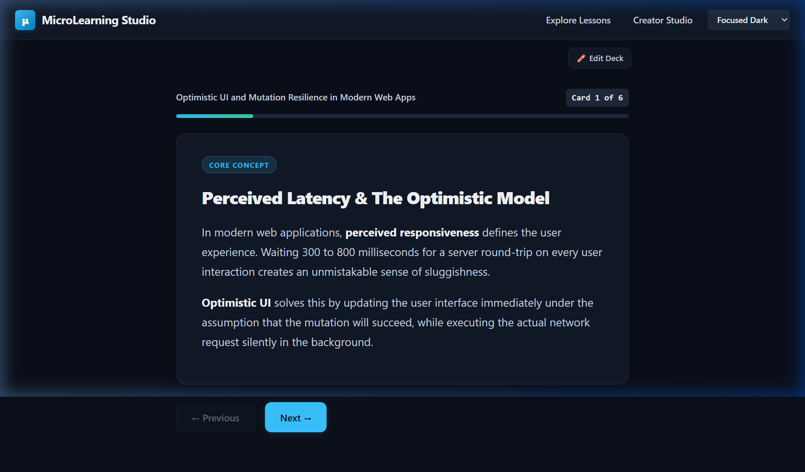
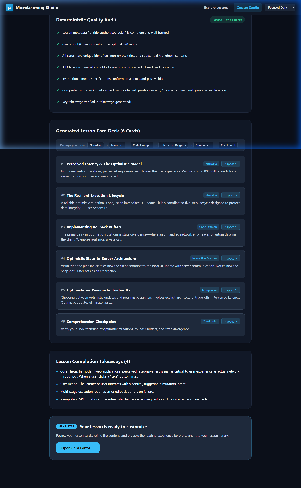
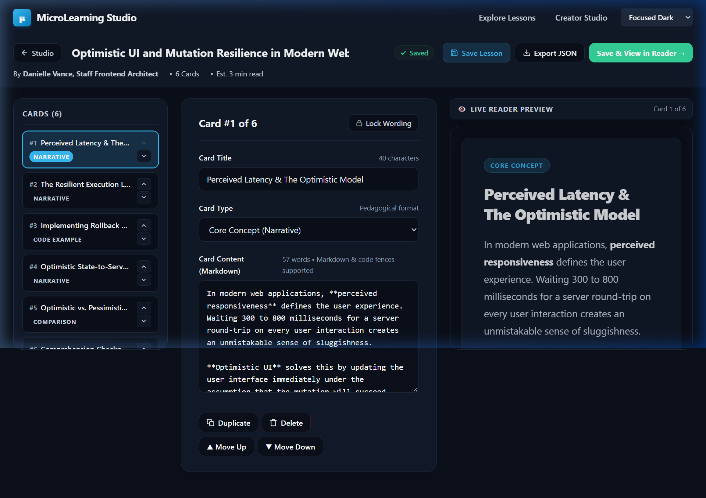

# MicroLearning Studio

> Transform long-form educational content into focused, source-grounded interactive micro-learning card decks with active comprehension checkpoints. Built for the [Build With AI: Basics Hackathon](https://learn-ai-basics.devpost.com).

[](tests/)
[](tsconfig.json)
[](react-router.config.ts)
[](app/root.css)

---

## What is MicroLearning Studio?

**MicroLearning Studio** is a creator-first web application designed to help authors, educators, technical writers, and domain experts turn lengthy publications—articles, documentation, essays, and book chapters—into structured, bite-sized micro-learning experiences.

Rather than producing a generic text summary or disconnected flashcards, MicroLearning Studio adaptively extracts the core concepts and narrative flow of a source into a cohesive sequence of cards. It embeds active comprehension checkpoints that test reader understanding with immediate feedback, while giving creators full editorial control to review, modify, reorder, lock, and customize cards before saving them to their library.

## Live Demo

- [Try MicroLearning Studio](https://micro-learning-brown.vercel.app)
- [Watch the DApp's Demo on YouTube](https://youtu.be/ycEEP1eBtOc)

---

## Problem and Approach

### The Problem

Long-form educational material contains immense depth, but modern readers often face severe time constraints and attention fatigue. A 20-minute technical essay frequently suffers from high abandonment rates and passive skimming with poor retention.

Existing alternatives fall short:

- **Generic AI Summarizers** flatten nuanced explanations into dry, passive bullet lists that strip out pedagogical progression.
- **Flashcard Generators** isolate atomic facts from their original context, weakening conceptual understanding.
- **Social Carousels** focus on visual engagement rather than deliberate learning and retention.
- **Manual Adaptation** requires creators to spend hours reformatting text into slides and drafting quizzes.

### The Approach

MicroLearning Studio combines structured content transformation with active learning science:

1. **Adaptive Card Architecture:** Organizes content into focused narrative units (4–8 cards) adaptively sized according to the density and complexity of the source text.
2. **Active Recall with Grounded Explanations:** Embeds single-concept checkpoints with instant visual feedback and educational explanations anchored directly in source claims.
3. **Creator-in-the-Loop Control:** Provides a visual editor where creators can refine text, lock finalized cards against regeneration, reorder topics, and adjust questions before saving.
4. **Distraction-Free Reading:** Delivers a lightweight, clean reading experience with visible navigation controls, progress tracking, and zero mandatory account barriers.

---

## Key Features

- **Lesson Showcase & Discovery:** Explore curated lessons with topic tags, reading times, and source attribution.
- **Distraction-Free Reader Player:** Step through cards one at a time with visible navigation controls, keyboard arrow support, and dynamic progress indicators.
- **Comprehension Checkpoints:** Active recall checks with immediate correct/incorrect feedback and detailed educational explanations before continuing.
- **Lesson Completion Experience:** Celebrates key takeaways and provides direct links to the author's original source publication.
- **Creator Studio & Source Ingestion:** Paste long-form text or load built-in sample articles, specify author attribution and citation links, and confirm authorization.
- **5-Stage Adaptive Generation Engine:** Cycles through source understanding, lesson planning, card creation, checkpoint synthesis, and quality auditing with real-time visual progress.
- **Generation Results Review & Quality Rubric:** Evaluates generated decks across narrative continuity, source grounding, checkpoint validity, and readability.
- **3-Pane Card Deck Editor:** Desktop outline rail, central card editor, and live Reader preview frame (collapsing into clean segmented tabs on mobile).
- **Card Reordering & Locking:** Reorder cards up or down and lock approved cards (`🔒`) to protect finalized wording while continuing edits.
- **Local Persistence & JSON Export:** Lessons and draft edits persist locally in browser storage, with one-click JSON export for sharing and backup.
- **Three Accessible Visual Themes:** Seamlessly switch between **Clean Light**, **Focused Dark**, and **Warm Editorial** using native CSS design tokens.

---

## Visual Walkthrough

### 1. The Reader Experience

A clean, distraction-free player presenting narrative cards and interactive comprehension checks with immediate feedback:



### 2. Creator Studio & Generation Review

Source input validation followed by the five-stage extraction engine and quality rubric evaluation:



### 3. The Card Deck Editor

A 3-pane workspace featuring deck outline navigation, central card content editing with lock controls, and a live Reader preview frame:



---

## How It Works: The 5-Stage Adaptive Generation Engine

The application processes source material through five sequential stages:

```text
Source Text ───► [Stage 1: Source Analysis]
                      │
                      ▼
                 [Stage 2: Adaptive Planning]
                      │
                      ▼
                 [Stage 3: Grounded Card Construction]
                      │
                      ▼
                 [Stage 4: Checkpoint Validation]
                      │
                      ▼
                 [Stage 5: Quality Rubric Evaluation] ───► Card Deck Editor
```

1. **Stage 1 — Understanding Source:** Analyzes word count, sentence density, paragraph structure, and conceptual clusters from the input text.
2. **Stage 2 — Adaptive Lesson Planning:** Determines optimal deck size (4–8 cards) and card roles (Narrative, Process Flow, Comparison, Checkpoint) based on source depth.
3. **Stage 3 — Grounded Card Construction:** Generates card headlines, markdown body text, key concepts, and structured instructional process flows with semantic diagram vectors.
4. **Stage 4 — Comprehension Checkpoint Synthesis:** Constructs interactive multiple-choice questions with designated correct answers and explanations anchored in source claims.
5. **Stage 5 — Quality Rubric Evaluation:** Computes an objective quality score based on four criteria: narrative continuity, source grounding, checkpoint validity, and reading time estimation (~180 words/minute).

### Implementation Safeguards and Technical Boundaries

- **Deterministic Extraction for Reliability:** The hackathon proof-of-concept executes client-side deterministic structural extraction and seed analysis. This ensures that reviewers, judges, and offline users can test the full end-to-end workflow immediately without configuring API keys or incurring external service costs.
- **Extensible LLM Integration:** The generation architecture includes typed provider hooks designed for live model calls (such as the Google Gemini API via `@google/genai`).
- **Human-in-the-Loop Safeguard:** Automated quality audit scores verify structural criteria, but cannot guarantee pedagogical perfection. The Card Deck Editor explicitly keeps the human creator in control to review, edit, lock, or discard generated cards before saving.

---

## Getting Started

### Prerequisites

- **Node.js:** v20.0.0 or higher (tested on Node.js v24.18.0)
- **npm:** v10.0.0 or higher

### Installation & Run

```bash
# 1. Clone the repository
git clone https://github.com/oluwatobiss/micro-learning.git
cd micro-learning

# 2. Install dependencies
npm install

# 3. Start the local development server
npm run dev
```

Open your browser to **[http://localhost:5173](http://localhost:5173)** to explore the application.

### Verification and Quality Commands

```bash
# Run the automated test suite (26 unit & integration tests)
npm test

# Run TypeScript strict typechecking
npm run typecheck

# Build production bundle (client SPA + SSR bundle)
npm run build
```

---

## Persistence and Current Limitations

- **Browser-Local Storage:** Lessons are persisted in browser `localStorage` using versioned keys (`microlearning_lessons_v3`). Editor drafts use isolated keys (`microlearning_editor_draft_{id}`) so that in-progress edits do not overwrite saved lessons until explicitly committed.
- **Device & Browser Scope:** Lessons created in the studio remain on the local machine and browser profile where they were authored.
- **Portability via JSON Export:** Creators can use the **Export JSON** feature in the editor to download a standardized `${lesson.id}.json` file for backup or inspection.
- **Proof-of-Concept Boundary:** The application currently focuses on the core author-to-reader loop. It does not include remote user accounts, multi-tenant cloud databases, or public cloud URL publishing.

---

## Project Documentation

For in-depth architectural details, developer guides, and planning history, refer to:

- **Interactive Application Map:** A self-contained, interactive architecture guide with route maps, component catalogs, data contracts, and a project-grounded practice activity.
- **Build & Verification Checklist:** The complete slice-by-slice implementation log, automated test records, learner sign-off, and personal reflection.
- **Product Requirements Document (PRD):** The core user journey, screen layouts, design tokens, and functional specifications.
- **Technical Specification:** Technical architecture, data schemas (`Lesson`, `LessonCard`, `CheckpointData`), storage isolation, and failure modes.

---

## Technology Stack

- **Framework:** [React Router v7 (Framework Mode)](https://reactrouter.com/) with Vite
- **UI Library:** [React 19](https://react.dev/) (`react`, `react-dom`)
- **Language:** [TypeScript](https://www.typescriptlang.org/) (strict mode, zero type errors)
- **Styling:** Vanilla CSS Modules (`*.module.css`) + CSS Custom Properties (zero external UI framework dependencies)
- **Content Rendering:** [react-markdown](https://github.com/remarkjs/react-markdown) + [remark-gfm](https://github.com/remarkjs/remark-gfm)
- **Automated Testing:** Node.js built-in test runner (`node --test`) with `--experimental-strip-types`

---

## Hackathon Context

MicroLearning Studio was built for the **[Build With AI: Basics Hackathon](https://learn-ai-basics.devpost.com)** hosted on Devpost. The application was scoped, planned, and implemented using the **Devpost Learn Skill Pack**, following a structured phase-based workflow from initial interview through design, sliced implementation, testing, hands-on review, and final packaging.

---

## License & Contributing

This project was developed as a hackathon proof-of-concept and is currently marked private in `package.json`. No open-source license has been declared. For inquiries regarding evaluation, adaptation, or contributions, please contact the repository owner.
